# CafePOS

**An offline point of sale and owner dashboard for a small neighborhood cafe in Tunisia.**
Tap-to-order till for the cashier, shift receipts, ingredient-level stock and a monthly profit
report for the owner, all running on one Windows laptop with no internet connection.


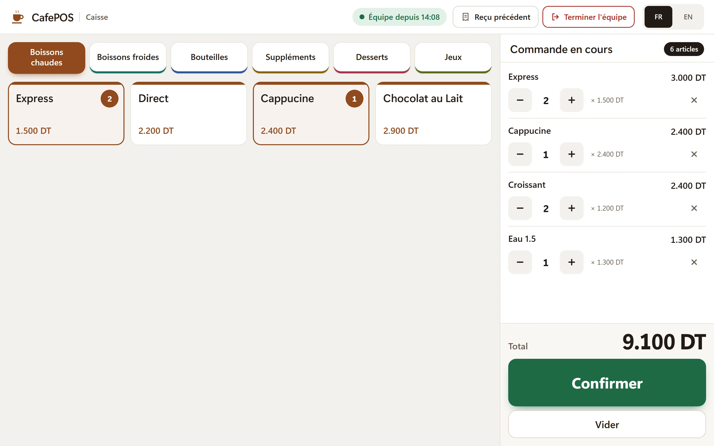

> All names, prices, costs, recipes, expenses and sales in these screenshots are **generated demo
> data**, not a real cafe's figures. The demo owner PIN is `1234`.

## Why

The cafe ran on pen and paper. The owner wanted to know what was sold each shift, what each drink
really costs him and whether the month is profitable, without having to learn "software". That
set the constraints:

- **Offline first.** No reliable internet, so no cloud: one laptop, one SQLite file, and the
  owner's phone on the cafe Wi-Fi.
- **Nothing to configure.** One-click setup, desktop icons, automatic nightly backups, updates
  that check their own result.
- **Built for the counter.** Big tap targets, French by default (English one tap away), prices
  in Tunisian dinars with 3 decimals.

## Features

### Till (`/pos`, no login)
- Category tabs and large product tiles; change quantities, remove a line, clear, confirm.
- **Shifts ("équipes").** The cashier ends a shift (with a confirmation); the till locks and shows
  the shift receipt: items x quantity, number of orders, total, and cancelled orders listed
  separately. "New shift" (also confirmed) unlocks it. "Previous receipt" reopens the last one.
- A sale is never blocked by stock: missing stock goes negative and shows up on the dashboard.
- FR / EN switch in the header.

### Owner dashboard (`/admin`, PIN login)
- Sales today, sales this month, estimated net profit for the month, out-of-stock ingredients,
  and the latest shifts.
- Orders list with cancellation (the stock is put back).
- Shift history, each shift with its receipt; a shift can also be ended from here.
- Change PIN. Works from a phone browser over the local Wi-Fi.

### Stock and recipes
- Products have **ingredient-level recipes** (e.g. Express = 9 g coffee + 5 g sugar), giving a
  **cost per item and margin**. Recipes with an unknown quantity are flagged and their cost is
  shown as an estimate.
- Ingredients have a unit, a package size and a last unit cost; every change goes through a
  **stock movement ledger** (purchase, sale, cancellation, manual adjustment with a note).
- Purchases add stock and update the ingredient's unit cost.
- Fixed expenses (rent, salaries, ...) are monthly or periodic (every N months).

### Reports
- **Monthly report:** sales, estimated cost and margin per product, fixed expenses brought to a
  monthly amount, stock in/out per ingredient, and net profit
  (sales - purchases - fixed expenses, cash basis; cancelled orders excluded).

### Reliability and deployment (Windows)
- Ships with a portable PHP: the laptop needs nothing installed.
- One-click setup (`deploy\setup.bat`): database, firewall rule for the phone, nightly backup
  task, desktop icons that open the till and the dashboard in their own Edge/Chrome app window.
- Nightly backups with SQLite `VACUUM INTO` (safe while the app runs), keeping the newest 30.
- Small update zips that stop the app, back up, copy only code and assets, migrate, and verify
  that the order count and total are unchanged before reopening the till.
- A one-file repair script for a broken install.

## Screenshots

| | |
|---|---|
| 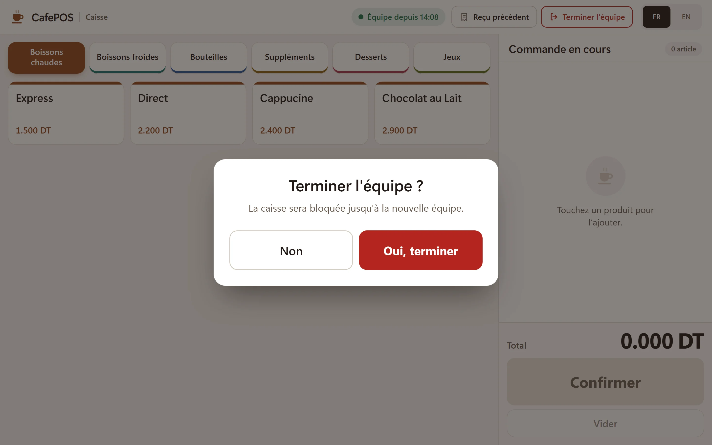 | 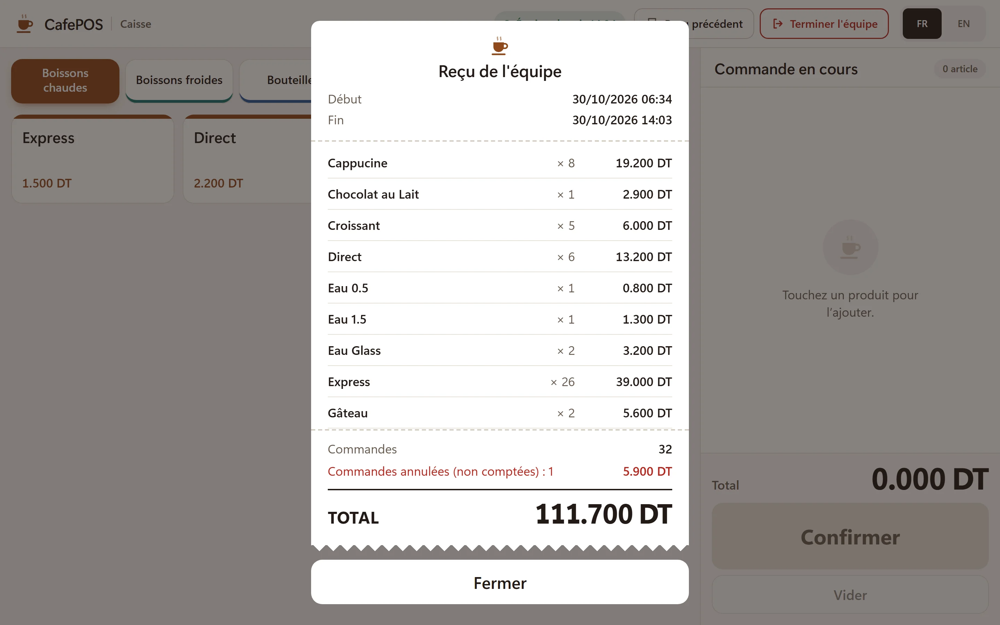 |
| **Ending a shift** asks for confirmation; the till then locks. | **Shift receipt:** items x qty, orders, cancelled orders apart, total. |
| 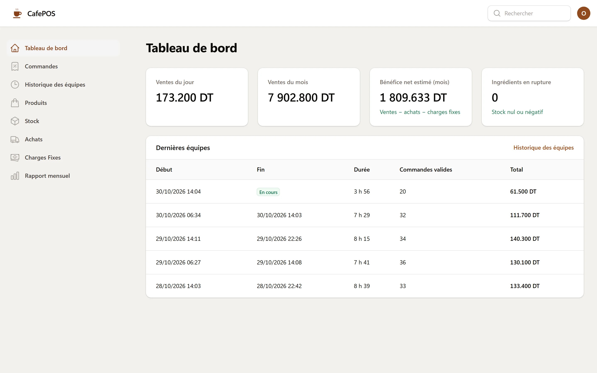 | 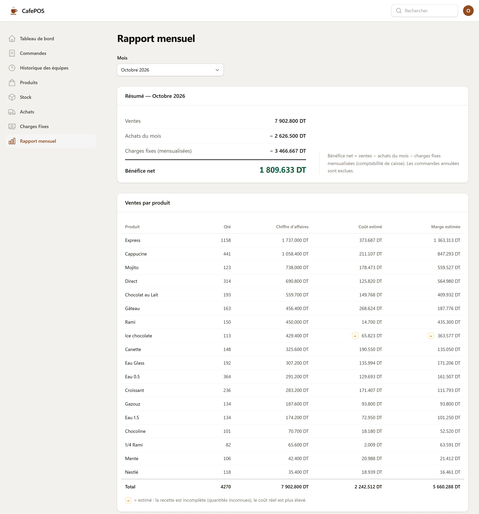 |
| **Dashboard:** today, month, estimated profit (a week into the month, fixed expenses still outweigh sales), stock alerts, latest shifts. | **Monthly report:** net profit, then cost and margin per product (`~` = estimate from an incomplete recipe). |
| 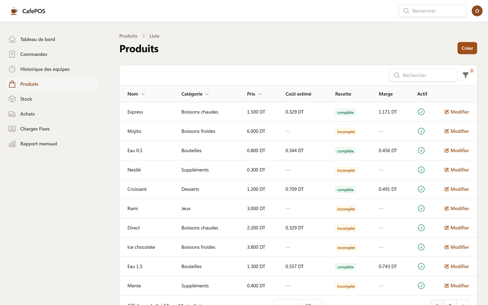 | 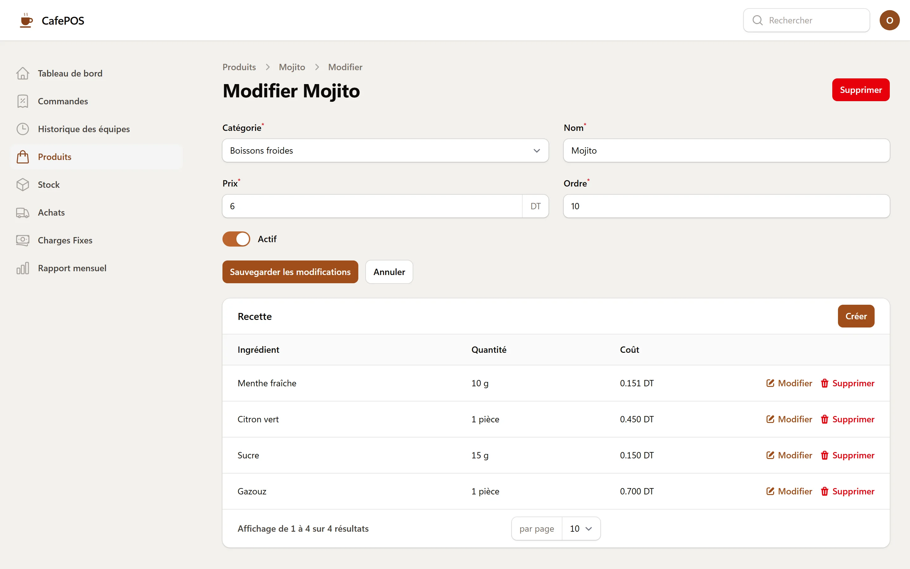 |
| **Products** with estimated cost, recipe status and margin. | **Recipe** of a product, costed per ingredient. |
| 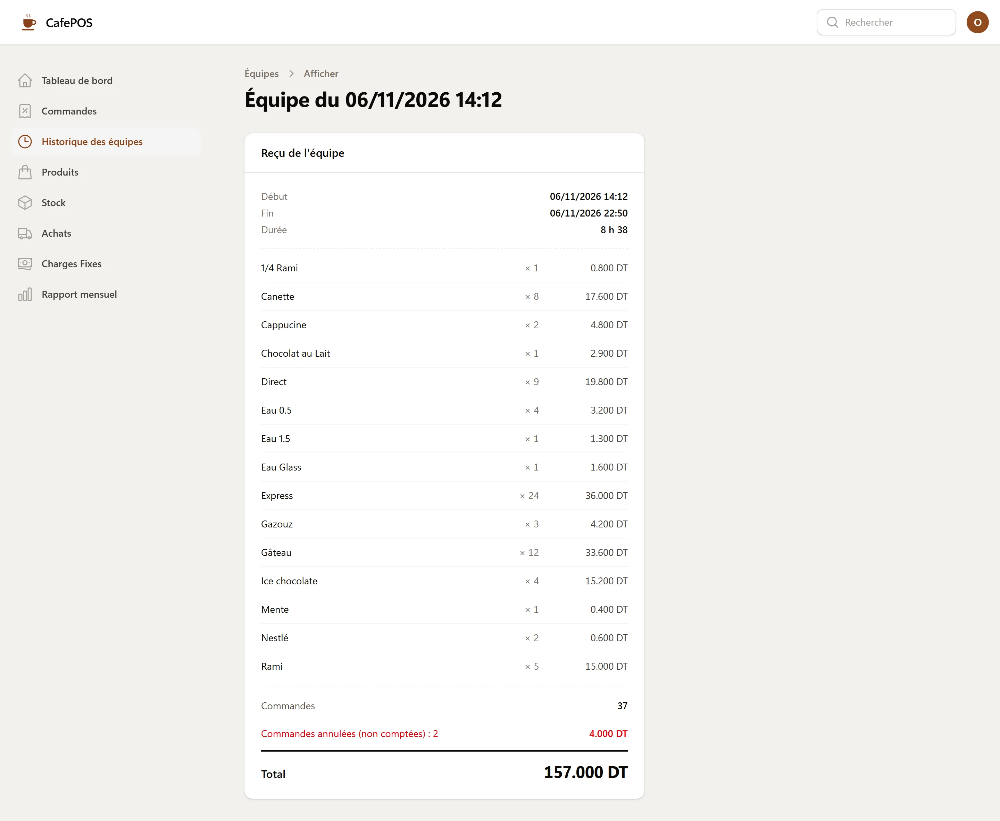 | 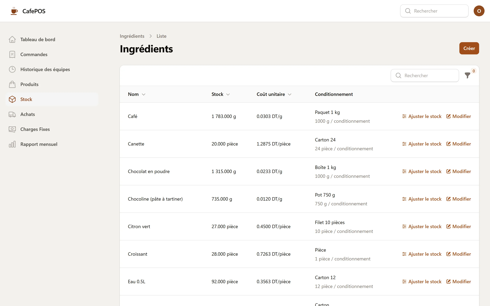 |
| **Shift history:** any past shift's receipt, including cancellations. | **Stock:** levels (negative in red), unit cost, packaging, stock adjustment. |
| 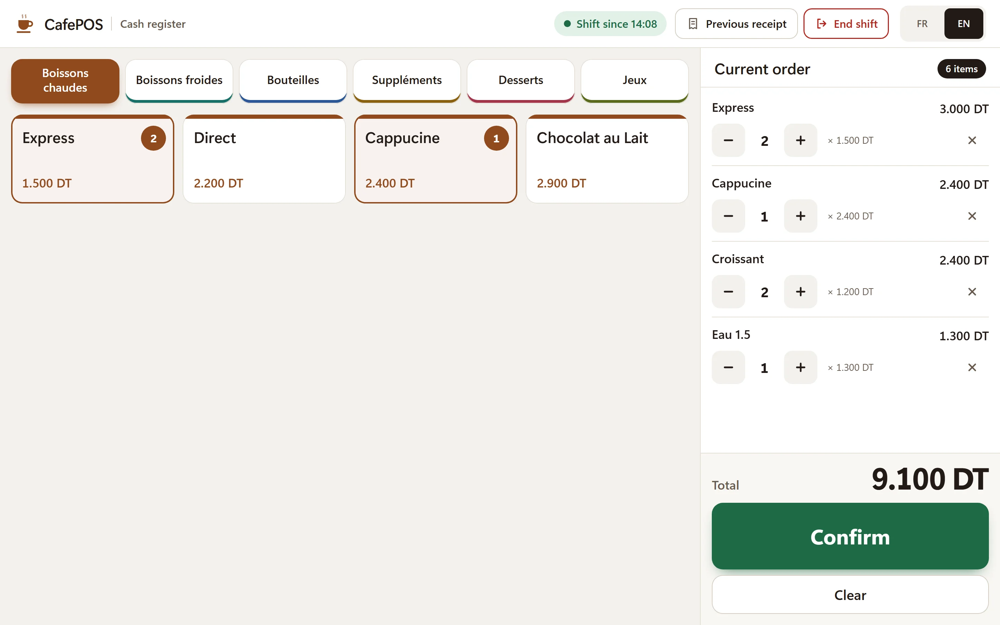 | 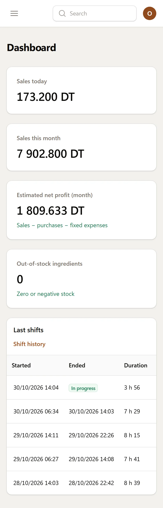 |
| **English UI** in one tap (menu items keep their French names). | **On the owner's phone** over the cafe Wi-Fi. |

## Architecture

- **Laravel 13 + Filament 5** for the owner panel; the till is a single **Livewire 4** component
  (`app/Livewire/Pos.php`) styled with Tailwind CSS 4.
- **Business logic lives in services**, not in UI code, so the till, the admin actions and the
  tests all go through the same paths:
  - `OrderService`: creates an order from a cart in a transaction, snapshots product names and
    prices on the order lines, deducts stock per recipe line; cancelling is idempotent and
    reverses the sale movements.
  - `ShiftService`: one open shift at a time (row lock), idempotent end, receipt recomputed from
    the orders every time so a later cancellation shows up.
  - `PurchaseService` / `StockService`: purchases and manual adjustments, each written as a
    stock movement.
  - `MonthlyReport`: sales per product, estimated costs, monthly share of fixed expenses, stock
    in/out and net profit for any month.
- **Stock ledger:** `stock_movements` records every change with its reason and source (order or
  purchase); `current_stock` is the running balance.
- **Money:** TND with 3 decimals everywhere (decimal columns, rounding to 3 places, one
  `Money::format()` helper that does not depend on ext-intl).
- **SQLite in WAL mode** with a 5 s busy timeout, so the till and the owner's phone can use it at
  the same time.
- **i18n:** French by default, English through `lang/en.json` / `lang/fr.json`; the choice is kept
  in the session (`SetLocale` middleware).
- **Auth:** a single owner account whose password is the PIN (hashed); the till needs no login.

## Testing

113 Pest tests cover orders and cancellations, stock deductions, recipes and costing, purchases,
shifts and receipts, the monthly report, the till component, admin actions, locale switching,
PIN login and the backup command.

```bash
php artisan test --compact
vendor/bin/pint --dirty
```

## Run it locally

Requires PHP 8.3+, Composer and Node.

```bash
composer install
npm install
npm run build              # or: npm run dev
cp .env.example .env
php artisan key:generate
php artisan migrate --seed # creates database/database.sqlite if asked; seeds the demo menu
php artisan serve
```

- Till: <http://localhost:8000/pos>
- Dashboard: <http://localhost:8000/admin>, PIN `1234`

The seed contains the menu, ingredients, recipes and fixed expenses, but no sales: start a shift
on the till and take a few orders. `OWNER_PIN` in `.env` sets the PIN only when the owner account
is first created; afterwards change it from the dashboard ("Changer le PIN"). Re-running the seed
only adds missing items and never overwrites the owner's edits.

## Deploying to the cafe laptop (Windows)

The laptop needs nothing installed: the package ships a portable PHP, `vendor/` and the built assets.

On the development machine:

```powershell
powershell -ExecutionPolicy Bypass -File deploy\get-php.ps1   # portable PHP 8.3 -> deploy\php
powershell -ExecutionPolicy Bypass -File deploy\package.ps1   # builds assets, writes ..\cafepos-release
```

Copy the `cafepos-release` folder onto the laptop's local disk (e.g. `C:\CafePOS`; **not** a
OneDrive/Dropbox synced folder). Right-click `deploy\setup.bat` -> **Run as administrator**. It:

1. creates `.env` (production mode), the app key and a fresh database with the menu/recipes;
2. opens TCP port 8000 in the firewall (rule "CafePOS POS");
3. schedules a nightly backup at 23:30;
4. puts **Caisse CafePOS** (till) and **Gerant CafePOS** (dashboard) icons on the desktop;
5. prints the address for the owner's phone.

`deploy\setup-app.bat` is the app-only part (no admin rights, no system changes). Both are safe
to re-run: the existing `.env`, app key and database are kept. If you move the folder, run
`deploy\setup.bat` again (it refreshes the cached paths and the icons).

### Daily use

- **Start:** double-click **Caisse CafePOS**. It starts the server in the background if it is
  not running, waits until it answers (up to ~30 s, otherwise a message box explains what to do)
  and opens the till in its own Edge or Chrome app window. **Gerant CafePOS** does the same for
  the dashboard. There is no auto-start, and double-clicking again never starts a second server.
- **Stop:** the server stops when the owner logs off or shuts down the laptop.
  (`deploy\start-cafepos.bat` runs it in a visible console window instead.)
- **Phone:** `http://<laptop-IP>:8000/admin` on the same Wi-Fi, while the laptop is on and the
  app is started. Give the laptop a fixed address in the router (DHCP reservation) and disable
  sleep while the cafe is open.
- How the icon works: shortcut -> `conhost.exe --headless` -> hidden PowerShell ->
  `deploy\launch-cafepos.ps1` -> `deploy\start-cafepos.bat` (hidden). Launcher messages go to
  `storage\logs\launcher.log`. `CAFEPOS_PORT` changes the port; `CAFEPOS_NO_BROWSER=1` skips
  opening the browser (testing).

### Backups

- `php artisan app:backup` (or `deploy\backup.bat`) writes
  `storage\backups\cafepos-YYYY-MM-DD-HHmmss.sqlite` (UTC time) with `VACUUM INTO` and keeps the
  newest 30. It runs every night at 23:30 if the laptop is on (the app does not need to be started).
- Occasionally copy `storage\backups` to a USB stick: a backup on the same disk does not survive
  a dead laptop.
- To restore: restart the laptop (this stops the app), copy a backup over
  `database\database.sqlite`, then double-click the desktop icon.

### Updates and repair

- `deploy\make-update.ps1` builds a small `cafepos-<name>.zip` with code and assets only (never
  `.env`, the database, storage or `vendor`). On the laptop, **Mise a jour CafePOS.bat** stops the
  app, backs up the database, copies the files, runs the migrations, refreshes the icons, restarts
  the app and checks that the order history is unchanged.
- `deploy\fix-cafepos.bat` repairs an existing install in place (re-runs setup, keeps the data).

### Owner tasks

- **Change the PIN:** dashboard -> "Changer le PIN".
- **Milk quantities:** drinks with milk are seeded with an *unknown* milk quantity (their cost
  shows as an estimate). Fill it in: Products -> open the drink -> recipe -> Lait quantity.

## Pour le patron (en français)

**Pour démarrer** : double-cliquez sur l'icône **Caisse CafePOS** du bureau. La caisse s'ouvre
dans sa propre fenêtre après quelques secondes. L'icône **Gerant CafePOS** ouvre le tableau de
bord. Refaites-le après chaque redémarrage de l'ordinateur (l'application ne démarre pas toute
seule). Si vous double-cliquez alors qu'elle tourne déjà, la caisse s'ouvre simplement à nouveau.

**Arrêter** : rien à faire. L'application s'arrête quand vous éteignez l'ordinateur ou fermez
votre session.

**Tableau de bord sur le téléphone** : le téléphone doit être connecté au Wi-Fi du café, et
l'ordinateur doit être allumé avec la caisse démarrée. Ouvrez
`http://<adresse-de-l-ordinateur>:8000/admin` (l'adresse, du type `192.168.1.20`, est affichée à
la fin de l'installation), puis entrez votre PIN (1234 au départ, changez-le dans "Changer le
PIN"). Ajoutez la page aux favoris. Pour que cette adresse ne change jamais, demandez à fixer
l'adresse de l'ordinateur dans la box (réservation DHCP).

**Sauvegardes** : faites automatiquement chaque nuit à 23h30 dans `storage\backups`, si
l'ordinateur est allumé à cette heure-là. De temps en temps, copiez ce dossier sur une clé USB.

---

The bilingual PDF user guide is generated from `docs/guide-src` and is not committed.
